# Matter intake review

Source-linked intake for a personal-injury law office. Intake staff register a short bundle of documents, the pipeline proposes candidate facts with a source for each one, and a separate quality gate blocks "Ready for attorney" until the open conflicts and unreadable files are dealt with. The attorney reads the released report. The pipeline does not decide the case.

This is the CEN 4010 final-project prototype for David Alzate. It follows the Assignment 2 design: Document Intelligence, with the quality gate kept as its own check.

Repository: https://github.com/carefiesta/matter-intake-review

## The problem

Staff receive two to four documents for a possible new matter (an intake form, a description of the incident, a clinic note, an email). They retype names, dates, parties, injuries, and insurers into a short packet for an attorney. The source of a sentence gets lost. The same fact can show up twice with different values and no record of the clash. A required item can be missing and the packet can still look finished.

The need is operational: one current, source-linked, staff-reviewed picture of the inquiry. Representation, legal analysis, advice, valuation, and contact with anyone outside the office stay with the attorney.

## Who it is for

| Role | What they do here | What they do not do |
| --- | --- | --- |
| Intake staff | Register files, accept or correct candidates, dispose flags, mark the report ready after the gate passes | Give legal advice, accept the case, contact the other side |
| Office administrator | See matters they are granted, read the audit log, publish a checklist version for new matters | Approve facts or mark a report ready |
| Attorney reviewer | Read a released report, acknowledge it, or send it back | Write facts inside the pipeline |
| The pipeline | Register, extract candidates, flag gaps, draft the seven-section report from approved facts | Approve itself, pick a conflict winner, decide liability, send a message |

## What the prototype does

1. Register a bundle of 2 to 4 files on one matter. Each file gets an id, type, channel, time, length, version, and the label Supplied.
2. Store the original bytes. Uploading the same filename again creates a new version and keeps the old one.
3. Extract candidate facts. Each candidate has a type, value, document id, locator, excerpt, and status Candidate. The label is Generated-Candidate.
4. Flag missing checklist items, duplicates, conflicts, and files that could not be read. A conflict has no winning value.
5. Let staff accept, edit, reject, or split a candidate, and dispose each flag.
6. Block Ready for attorney while a conflict or an unreadable file is still open, or while the prohibition scan fails.
7. Compose a seven-section report from approved facts only, plus the locked notice.

Every call carries a user, a role, and (once a matter exists) a matter id. A person who is not on a matter gets no records from it.

## Architecture

```mermaid
flowchart LR
  staff[Intake staff]
  guard[Access guard]
  ingest[Ingestion]
  docs[Document store]
  extract[Extraction service]
  facts[Fact store]
  flags[Flag engine]
  bench[Review workbench]
  gate[Quality gate]
  report[Report service]
  attorney[Attorney reviewer]

  staff --> guard
  guard --> ingest
  ingest --> docs
  docs --> extract
  extract --> facts
  facts --> flags
  flags --> bench
  bench --> gate
  gate --> report
  report --> attorney
```



The extraction service may write only candidates and the first flags. The report service reads the approved side. It cannot set Ready. The attorney sits outside the pipeline: acknowledgment does not change a fact.

The default extractor is a fixed set of line rules (`fixture-extractor` 1.0.0). It needs no key. A remote language model can be turned on with an environment variable. It uses the same interface, and a fact is dropped if its excerpt is not in the source. The model is never given a way to mark a fact approved or to send a message.

More detail is in [docs/architecture.md](docs/architecture.md). The requirement map is in [docs/traceability.md](docs/traceability.md).

## Prerequisites

- Python 3.11 or 3.12
- A terminal
- No API key

## Setup

From the repository root:

```bash
python3 -m venv .venv
source .venv/bin/activate
pip install -r requirements.txt
python -m intake.cli init
python -m intake.cli load-samples --user casey.lin --password intake-demo
```

`init` creates `data/intake.db` and four demo users. The shared password is `intake-demo`.

| User | Role |
| --- | --- |
| `casey.lin` | Intake staff. Loads the samples. |
| `morgan.ellis` | Office administrator |
| `riley.brooks` | Attorney reviewer |
| `sam.patel` | Intake staff with no sample matters. Use this account to see the access check. |

## Configuration

Copy `.env.example` to `.env` only if you want to change a setting. Do not commit `.env`. Do not put a real key in the repository.

| Variable | Default | Meaning |
| --- | --- | --- |
| `LLM_PROVIDER` | `fixture` | `fixture` uses the local rules. `remote` calls an HTTP language model. |
| `LLM_BASE_URL` | empty | Used only when the provider is `remote`. |
| `LLM_API_KEY` | empty | Used only when the provider is `remote`. |
| `LLM_MODEL` | empty | Model name sent to that endpoint. |
| `INTAKE_DB` | `data/intake.db` | SQLite file. |
| `INTAKE_SESSION_SECRET` | a local development value | Cookie signing secret. Set one of your own if you share the machine. |
| `PORT` | `8000` | Web port. |

The remote provider is off unless `LLM_PROVIDER=remote`. A key in the environment does nothing while the provider is `fixture`.

## Run

Web workbench:

```bash
python -m intake.cli serve
```

Open http://127.0.0.1:8000 and sign in as `casey.lin`.

Command line (same rules, same database):

```bash
python -m intake.cli list --user casey.lin --password intake-demo
python -m intake.cli show --user casey.lin --password intake-demo --matter M-0002
python -m intake.cli gate --user casey.lin --password intake-demo --matter M-0002
python -m intake.cli report --user casey.lin --password intake-demo --matter M-0002 --audience attorney
```

Matter ids come from `list`. They start at `M-0001` on a fresh database after `load-samples`.

### A path through the samples

1. Open **Nguyen parking-lot inquiry**. The incident date is March 3 in one file and March 5 in another. Incident time and insurer are missing. The insurer email says the insured was at fault; that sentence is a supplied quotation, not an approved finding.
2. Choose **Mark ready for attorney**. The gate blocks the change and names the open conflict.
3. Dispose the conflict (for example, Escalated to attorney) and mark ready again. The missing items stay in Open questions. They do not by themselves block Ready. That matches the Assignment 2 rule used here: conflicts and unreadable files block; a disposed duplicate does not.
4. Sign out. Sign in as `riley.brooks`. Open the released report. Acknowledge it, or send it back. The fact list does not change.
5. Open **Ortiz bicycle inquiry**. One file is unreadable, one is bound to a different matter, and one is a `.pdf` this prototype does not read. None of those three produce facts. Ready stays blocked until the unreadable file is disposed.
6. Open **Hale sidewalk inquiry**. The incident date is written two ways (`March 4, 2026` and `03/04/2026`). That is a duplicate, not a conflict, and both sources stay. Check the facts you want in the packet, accept them, and mark ready. The attorney report lists only the approved facts. The sample SSN and account number are masked.

To see a new document send a released matter back, mark Hale or Nguyen ready, then add `samples/nguyen-conflict/later-insurer-note.txt` from the matter page or with `add-file`. The old review history stays. A new date conflict returns the status to Returned for revision.

## Test

```bash
pytest
```

The tests cover the normal path and the failure cases (unsupported file, wrong matter, unreadable file, conflict, cross-matter read, prohibited wording, blocked Ready). See [docs/traceability.md](docs/traceability.md) and [docs/validation.md](docs/validation.md).

## Sample data

Everything under `samples/` is fictional. Names, phone numbers, the SSN `900-12-3456`, and the account number are made up. Do not replace them with real client files.

| Folder | What it is for |
| --- | --- |
| `samples/hale-clean` | Consistent bundle. Same incident date in two formats. Masked identifier. |
| `samples/nguyen-conflict` | Conflicting dates, a duplicate name, missing time and insurer, a fault sentence kept as a quotation. `later-insurer-note.txt` is not loaded with the bundle. |
| `samples/ortiz-exceptions` | One readable intake, one unreadable file, one file bound to `M-OTHER`, one `.pdf`. |

The line rules look for labels such as `Client:`, `Incident date:`, `Parties:`, and `Quote:`. A file that is not `.txt` or `.md` is stored and marked unprocessed. A line `Matter-Binding: SOME-OTHER-ID` holds that file out of extraction.

## Known limitations

- The default extractor only reads labeled lines. It will miss a fact that is written as a paragraph.
- If any line in a file is marked unclear, or the file is marked unreadable, that file contributes no facts and blocks Ready until staff dispose the flag.
- "March 4, 2026" and "03/04/2026" match. "Early March" does not match a specific day, so it conflicts with one. The office has not confirmed that rule (Q2).
- Missing checklist items are shown as open questions. They do not block Ready. Conflicts and unreadable files do. Q1 and Q9 are still open; this is the conservative rule from Assignment 2.
- Demo sign-in is a shared password in a local SQLite file. It is enough to show the access check. It is not office-grade authentication.
- Text files only. No live email, no PDF text layer, no encryption story beyond the local file.
- One checklist and one report template are implemented. A matter keeps the version it was created with.
- The 120-second and 3-second targets are checked in tests. They are course ceilings, not a measured office number (Q5).

## Out of scope

Legal conclusions, claim value, representation decisions, and any message or filing to a client, insurer, provider, court, or opposing party. Also out of scope: calendars, tasks, negotiations, docketing, live mailbox capture, and training on real client records.

## Before you submit

This repository is the running prototype. The course also asks for an updated solution-design report, a demonstration, and a presentation. Those are still yours:

- Update the Assignment 2 report so it describes this prototype, what you observed, and what is still out of scope. Link this repository and the local run steps.
- Record a short demo of the Nguyen conflict path and the Hale approval path, in your own words.
- Fill in [docs/ai-assistance-log.md](docs/ai-assistance-log.md) after you review the code. Say what you kept, what you changed, and how you checked it.
- Proof of demand is not claimed. A real intake interview is still open if you want that extra credit.
- Q1, Q3, Q5, Q9, Q10, and Q11 were still unanswered by an office in Assignment 2. Say that plainly in the report.

## License

MIT. See [LICENSE](LICENSE).
